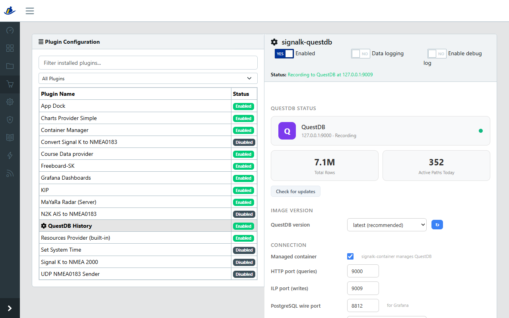

# signalk-questdb

Keeps the history of your boat's data. The plugin records what Signal K sees,
from your own instruments and from the AIS targets around you, in a
[QuestDB](https://questdb.com) database. Apps that draw tracks and graphs get it
back through Signal K's History API, and Grafana can read it too.

It replaces signalk-to-influxdb and signalk-to-influxdb2, and imports the
history they recorded.

- **Looks after itself.** QuestDB runs in a container that the plugin sets up,
  updates and keeps healthy.
- **Small on disk.** A value that changes is written at most every 2 seconds, a
  value that stays the same only every 5 minutes.
- **Keeps your track.** Old data can be deleted after a number of days, while
  your own track is kept for good.
- **AIS back at once.** After a restart, the vessels around you are on the chart
  right away instead of trickling in over minutes.
- **Imports** history from InfluxDB, and tracks from a chartplotter as GPX.
- **Exports** to Parquet or CSV.
- **SQL console**: QuestDB's own console inside the Signal K admin UI.

## Getting started

### Requirements

- Signal K server 2.31 or newer, on Node.js 24 or newer
- The [signalk-container](https://github.com/dirkwa/signalk-container) plugin,
  with Podman 5.4 or newer (what Debian 13 "trixie" ships) or Docker. Not needed
  if you run QuestDB yourself.

Which signalk-container version brings what is in
[Deployment](doc/deployment.md#requirements).

### Install

1. Install **signalk-container** from the App Store and enable it.
2. Install **signalk-questdb** and enable it. On its first start it downloads
   QuestDB, which can take a few minutes on a slow connection, starts it and
   begins recording.
3. Open the plugin's config panel. The status card shows **Running** and
   **Recording**.



To use a QuestDB you run yourself, switch **Manage QuestDB container** off and
enter its host and ports.

### Make it the history provider

Apps ask Signal K for history, and Signal K asks its default history provider.
Choose this plugin once under **Data → Preferences → Default History
Provider**; Signal K remembers the choice.

## Everyday settings

Every setting is in the plugin's config panel. These are the ones you are most
likely to change; all of them are in [Configuration](doc/configuration.md).

### How often is data recorded?

A value that changes is written at most once per **Default sampling rate**,
2 seconds by default. A value that stays the same is written again only once
per **Unchanged-value heartbeat**, 5 minutes by default, which keeps the
database small. Your position is the exception: it is written every 2 seconds
even while the boat lies still.

### How do I record the wind at full speed?

Add a line to **Per-path sampling rates**: a path pattern, then the rate in
milliseconds. A rate of 0 records every change:

```text
environment.wind.* 0
```

Everything else stays at the default. A value that repeats is still written
only once per heartbeat. To record repeats too, set the heartbeat to 0; that
applies to every path, each of which then writes at its sampling rate even when
nothing changes.

Full speed costs space and needs a capable machine: a wind sensor at 10 Hz
writes about 1.7 million rows a day for angle and speed. Use it for the few
paths that need it.

### How long is data kept?

Forever, unless you set **Retention (days)**; older days are then deleted. Your
own track is kept anyway, thinned to one position every 10 seconds (**Keep own
track** and **Archive resolution**). That is about 100 MB for a year of
recording around the clock. To keep other paths of your own boat the same way,
list them under **Archived own-vessel paths**, for example
`environment.depth.*`.

### AIS targets are gone after a restart

Signal K keeps live data in memory only, so after a restart the chart stays
empty until each vessel transmits again, which can take minutes. Switch on
**Restore vessels on startup**: the vessels recorded in the last 9 minutes
(**Restore max age**) come back at once, with name and ship type. They keep the
time they were recorded at, so the chart plotter ages them out like any other
target.

### Recording less

**Record own vessel** and **Record AIS targets** switch the two off separately.
Under **Path filtering**, patterns such as `propulsion.*` leave out the paths
they match, or, in `include` mode, record only those.

### Comparing two sensors

When Signal K's source priorities rank the sources of a path, only the preferred
one is recorded, the value your instruments show. Switch on **Record all
sources** to record the others too, for example to calibrate a sensor or to
compare two GPS receivers. Each source then writes its own rows.

## Common tasks

### Import history from InfluxDB

In the config panel, open **InfluxDB Migration**:

1. **Detect** finds an InfluxDB on this machine, or enter its address.
2. Enter its credentials, if it needs any, and pick the bucket (InfluxDB 2.x)
   or database (1.x).
3. Check which vessel in it is your own boat. Tick the box below to import the
   AIS targets as well.
4. Pick a time range and **Start import**.

A large import runs for hours. If it stops, **Resume import** carries on where
it left off. Afterwards, make sure this plugin is the default history provider,
and switch the InfluxDB plugin off once nothing else needs it. More in
[Import and export](doc/import-export.md).

### Import a track from a chartplotter

Export the track as GPX on the plotter. In the config panel, **GPX track
import** reads the file and lists its tracks, with the ones that look like your
own boat already ticked. Check them and press **Import**. Imported tracks are
kept for good, whatever the retention.

### Export data

**Data Export** in the config panel downloads the numbers recorded in a date
range as Parquet or CSV. For backups of every table, see
[Export and backup](doc/import-export.md#export-and-backup).

### Look at the data with SQL

Open the admin UI, go to **Webapps** and pick **signalk-questdb**: that is
QuestDB's own console. Only admins can open it, and it can delete data, so
stick to `SELECT`. The [Web Console guide](doc/web-console.md) has queries to
paste, such as speed in knots or distance per day.

### Grafana

The [signalk-grafana](https://github.com/dirkwa/signalk-grafana) plugin sets up
Grafana with QuestDB for you. To connect a Grafana of your own, see
[Grafana](doc/deployment.md#grafana).

### Update QuestDB

**Check for updates** in the config panel tells you whether a newer QuestDB is
out, and **Update** installs it. With the default image version `latest`, the
plugin also checks by itself after each update of the plugin. See
[QuestDB updates](doc/configuration.md#questdb-updates).

## When something goes wrong

- **"Module signalk-questdb is not available"** right after installing or
  updating: reload the browser tab with Shift-Reload.
- **"QuestDB keeps dropping the write connection"**: QuestDB is most likely
  running out of memory. [Troubleshooting](doc/troubleshooting.md) shows how to
  tell whether to raise **QuestDB memory limit** or to change a setting of the
  host.
- **History is slow, or "out-of-memory" errors although RAM is free**: the host
  allows QuestDB too few memory mappings. Run this on the host, not inside the
  container. It takes effect at once:

  ```bash
  echo 'vm.max_map_count=1048576' | sudo tee /etc/sysctl.d/99-questdb.conf
  sudo sysctl --system
  ```

- **WAL suspended** on the status card: QuestDB has stopped applying what it
  receives. The plugin resumes it by itself where it can. Otherwise the panel
  offers **Resume**, or **Skip** together with what skipping would lose.
- **"Cannot apply a change: the QuestDB container cannot be stopped or
  removed"**, a **QuestDB that never starts on macOS**, and more:
  [Troubleshooting](doc/troubleshooting.md).

## More documentation

- [Configuration](doc/configuration.md): every setting, and QuestDB updates
- [Recording](doc/recording.md): what is stored and how, retention and the
  archive, startup restore
- [History API](doc/history-api.md): the v1 and v2 APIs and the plugin's REST
  endpoints
- [Import and export](doc/import-export.md): InfluxDB, GPX, export and backup
- [Web Console](doc/web-console.md): exploring the data with SQL
- [Deployment](doc/deployment.md): requirements, networking, storage,
  durability, performance, Grafana
- [Troubleshooting](doc/troubleshooting.md)

## License

signalk-questdb 2.0.0 and later is **source available, not open source**. See
[LICENSE.md](LICENSE.md).

**You may**, free of charge: run it on your own boat or fleet, private or
commercial; use it for internal company operations; modify it for your own use;
use it in education and research; and provide professional services around it.

**You may not**: redistribute it, or publish a modified version of it to npm or
anywhere else. Verbatim copies of official releases may be mirrored and cached.

Versions 1.9.2 and earlier remain available under the MIT license, see
[LICENSE-MIT-through-v1.x.txt](LICENSE-MIT-through-v1.x.txt).

## Contributing

See [CONTRIBUTING.md](CONTRIBUTING.md).
